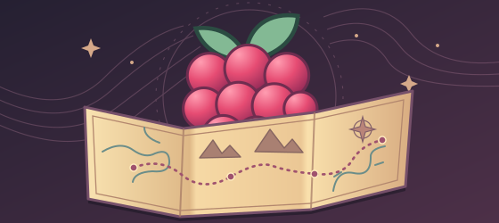

# MJl Pointcrawl — 1.0.19



Модуль путешествий для **Foundry VTT 14.361, dnd5e 5.3.3 и socketlib 1.1.4**. Русский интерфейс. Карта состоит из регионов и маршрутов с заданной мастером длительностью. Формат сетки сцены может быть любым: движение считается между точками, а не по клеткам.

## Установка

В Foundry → **Дополнительные модули → Установить модуль → Ссылка на манифест** вставьте:

```text
https://raw.githubusercontent.com/MJl2517/dnd-point-crawl-2024/main/module.json
```

Для ручной установки скачайте [mjl-pointcrawl.zip](https://github.com/MJl2517/dnd-point-crawl-2024/raw/refs/heads/main/dist/mjl-pointcrawl.zip) и выполните шаги ниже.

1. Распакуйте содержимое `mjl-pointcrawl.zip` в `<Foundry User Data>/Data/modules/mjl-pointcrawl/`. **Имя папки должно быть строго `mjl-pointcrawl`, без номера версии.** Файл `module.json` должен находиться непосредственно в этой папке, без дополнительного вложенного каталога.
2. Перезапустите сервер Foundry. В управлении модулями мира включите **MJl Pointcrawl** и **socketlib**.
   После обновления файлов уже установленного модуля обновите клиент через **Ctrl+F5**; это нужно сделать мастеру и всем подключённым игрокам.
3. Создайте отдельную сцену карты путешествий. Для неё достаточно фонового изображения; масштаб карты не влияет на длительность маршрутов.
4. Откройте **Pointcrawl** кнопкой с маршрутом в левой панели → **Менеджер регионов** → **Включить для этой сцены**. Режим отключает обычный Token Vision. При выключении он восстановит исходное значение, если мастер за это время не включил Token Vision самостоятельно.

## API интеграций

После `ready` проверяйте, включён ли модуль. Вызов `open()` открывает менеджер мастера или центр путешествий в зависимости от роли. `listNotebooks({sceneId})` возвращает объекты с полями `uuid`, `sceneId`, `regionId`, `locationId`, `name`, `label` и `published`. Если `sceneId` опущен, возвращаются доступные записи со всех сцен Pointcrawl. Для журнала всего региона `locationId` равен `null`. Игрок получает только открытые записи, на которые у него есть права наблюдателя. Мастер также получает записи о скрытых местах.

```js
const pointcrawl = game.modules.get("mjl-pointcrawl");
const api = pointcrawl?.active ? pointcrawl.api : null;
const notebooks = api?.version === 1 ? api.listNotebooks({sceneId: canvas.scene?.id}) : [];
```

Событие `mjl-pointcrawl.apiReady` передаёт API после инициализации. Событие `mjl-pointcrawl.refresh` сигнализирует об изменениях, после которых можно обновить список. Модуль сохраняет идентификатор `mjl-pointcrawl`.

Модуль не заменяет файлы Foundry или dnd5e. Данные путешествия сохраняются в мире. Удаление или отключение самого модуля не удаляет его журналы и регионы; перед отключением выключите режим сцены, чтобы убрать маску и восстановить Token Vision.

Порядок инструментов слева: **Центр путешествий → Переход → Менеджер регионов → Информация о регионе → Многоугольник → Прямоугольник → Редактирование границ → Центр региона → Палитра → Предпросмотр игроков**. Игрокам доступны первые два. Соединение центров щелчками убрано; маршруты создаются в менеджере на вкладке **Маршруты**.

## Офлайн-режим

На сцене путешествий откройте **Менеджер мастера → Партия и заявки → Офлайн-режим**. Включите режим и назначьте токен актёра «Группа». Его состав может быть пустым. В списке офлайн-участников можно указать имена с бумажных листов, по одному на строку. Если список пуст, в заявках используется одна запись «Группа». Режим и список сохраняются отдельно для каждой сцены. У каждого имени в офлайн-списке есть нейтральный портрет, который также виден в центре путешествий и заявках.

Создавайте переходы и заявки обычным способом. После одобрения нажмите **Ввести результат** и запишите итог броска с модификаторами. При провале навигации введите результат d6 со стола. При успешном сборе пропитания введите отдельно итоги для еды и воды. События по таблицам также принимают итог реального броска.

Мастер подтверждает отдых каждого участника. Последствия для персонажей, включая истощение за провал спасброска марша, записываются на бумажных листах. Модуль ведёт игровое время, маршрут, Сл. и результаты заявок.

## Окна модуля

- **Менеджер мастера**: регионы, маршруты, события и вкладка **Партия и заявки**. Здесь назначают токен группы, вызывают ручную навигацию и открывают текущие или прошлые заявки. Доступен только мастеру.
- **Центр путешествий**: отдельная кнопка с лагерем на панели Pointcrawl. Игроки видят партию, известные регионы и локации, выходы, темп, отдых, поиск и сбор. Активная заявка открывается отдельной кнопкой. Мастеру дополнительно видны скрытые локации с подписью «Скрыта от игроков». Во вкладке **Регионы** поле **Поиск** фильтрует названия регионов и локаций без учёта регистра. Найденная локация открывает её журнал. Игрок ищет только открытые места; мастер видит все.
- **Переход / заявка партии**: самостоятельное окно, которое открывается при попытке перехода или заявке действия. У активного мастера новая заявка появляется автоматически. Здесь он выбирает навигатора, меняет параметры, одобряет и завершает действие. Карточка в чате открывает это же окно, включая сохранённый итог завершённой заявки.
- **Заметки**: кнопка открывает обычный журнал Foundry с редактированием текста и созданием страниц. Такие же записи доступны в каталоге журналов, в папке **Pointcrawl → название сцены → Регионы / Локации**. У мастера в заголовке журнала есть отдельная кнопка **Pointcrawl · заметки мастера** с редактированием секретного текста.

Выпадающие списки используют системные цвета активной темы Foundry: фон пунктов и текст остаются согласованными в светлом и тёмном режиме.

Окна подстраиваются под содержимое. Длинные заметки и формы прокручиваются внутри окна. Декоративные заголовки и постоянные бейджи убраны; статусы заявки и предупреждения о несохранённых изменениях остаются.

После одобрения у игрока выбранного персонажа автоматически открывается окно проверки: персонаж, регион, направление, темп, длительность, навык, Сл. и последствия провала навигации. Кнопка **Бросить** запускает штатный диалог dnd5e; сам бросок без нажатия не выполняется. Неизвестный регион сохраняет скрытое название.

Если персонажем владеют несколько игроков, преимущество при назначении получает подключённый игрок, у которого он выбран основным персонажем в настройках пользователя; затем создатель заявки и другой подключённый владелец. Назначенный игрок указан в окне. Остальные владельцы не могут повторить проверку; мастер может выполнить её за отсутствующего участника. Закрытое окно не навязывается заново при каждом обновлении; его можно открыть из чата, а после переподключения незавершённая проверка появится автоматически. На безопасном маршруте окно броска игроку не открывается.

## Общие заметки в журнале Foundry

При подключении активного мастера модуль создаёт папку **Pointcrawl**, внутри неё папку сцены и разделы **Регионы** и **Локации**. Уже существующие регионы и локации получают журналы автоматически; повторное подключение не создаёт дубликатов. Мастер видит все журналы, включая ещё не исследованные места.

После открытия региона его журнал появляется у игроков с правом редактирования. Журнал локации доступен, когда открыт регион и раскрыта сама локация. Кнопка **Заметки** в центре путешествий или карточке региона открывает тот же штатный журнал. Используйте редактор текста или **Добавить страницу**; можно вести общие планы, находки и дневник партии. Владельцы редактируют общие страницы совместно. Для уже открытого журнала запись работает через штатный сервер Foundry, без заявки мастеру.

Краткое описание из карточки переносится в журнал при первом открытии места. У ещё не открытого места общая запись имеет нейтральное название и пустую начальную страницу; мастер видит настоящее название в списке и листе журнала из закрытого хранилища. Если мастер уже начал общие записи до открытия места, они сохраняются, а описание добавляется отдельно. После этого журнал — самостоятельная записная книжка: модуль не заменяет её содержимое при смене описания, перемещении партии или других обновлениях карты. Записи игроков и добавленные страницы сохраняются. В карточке остаётся отдельное краткое описание.

При повторном закрытии региона доступ игроков к его журналу и журналам локаций отзывается, включая индивидуальные разрешения. Текст не удаляется; при открытии региона доступ возвращается. При удалении локации или региона журнал сохраняется мастеру с префиксом **Архив**, без доступа игроков.

Секретный текст вводите через **Pointcrawl · заметки мастера** в заголовке журнала или через прежние поля карточки региона/локации. Это отдельные сведения в закрытом компендиуме, они не помещаются на общие страницы. Папка общих журналов создаётся и обслуживается модулем; её записи связаны с местами по постоянным идентификаторам.

## Подготовка регионов и маршрутов

1. На вкладке **Регионы** нажмите **Новый регион**. Используется штатный инструмент многоугольника Foundry: расставьте вершины, завершите рисование штатным жестом. Для обычного квадрата или прямоугольника есть отдельный инструмент на левой панели Pointcrawl. Каждое новое рисование на этой панели создаёт отдельный регион, даже если предыдущий был выделен.
2. Карточка нового региона открывается сразу после рисования. Её также можно открыть выбором области инструментом Pointcrawl, из менеджера или кнопкой в штатных настройках региона. Заполните карточку и сохраните.
3. Нажмите **Поставить центр** и щёлкните внутри границы. Отдельно сохранять новую карточку заранее не обязательно: эта кнопка сохранит введённые значения, а инструмент центра на левой панели зарегистрирует новый регион при щелчке. Если регион не выделен, инструмент выберет нарисованную область под щелчком. `Esc` отменяет выбор точки. Кнопка карточки не добавляется в палитру преднастроек.
4. Создайте второй регион. На вкладке **Маршруты** добавьте связь между двумя центрами, задайте время в часах и риск заблудиться. Связь работает в обе стороны.
5. Для изменения контура используйте **Редактировать границу** и штатные маркеры Foundry. После завершения рисования или редактирования пересекающаяся область обрезается по уже существующим регионам. Границы соседей не меняются. Центр и локации должны оставаться в свободной части: если редактирование их исключает, изменение отменяется с объяснением.

Поддерживаются прямоугольники, многоугольники, несколько контуров и настоящие отверстия. Если новый контур окружает старый регион, вокруг него автоматически образуется вырез. Если старый регион пересекает новый насквозь, остаются две части одного региона. Новая область, целиком занятая соседями, не создаётся. Самопересечение многоугольника по-прежнему считается ошибкой. Геометрия обрабатывается штатными PolygonTree и Clipper Foundry, без установки библиотек.

В карточке региона название и кнопка сохранения видны сразу. Остальные поля распределены по сворачиваемым разделам: **Местность и проверки**, **Описание для игроков**, **Заметки мастера**, **Карта и видимость**, **Локации**. Удаление находится в разделе **Дополнительно**. Состояние раскрытия сохраняется при обновлении окна, а значения закрытых полей сохраняются вместе с остальной карточкой. Если в скрытом поле есть ошибка, его раздел откроется при сохранении.

Открытый регион показывает игрокам описание, но не секретные заметки. Пресет местности заполняет Сл. навигации, поиска и пропитания, максимальный темп и справочную дистанцию обнаружения. После смены пресета сохраните карточку. Все значения можно изменить. У нового региона раздел карты открыт, пока не установлен центр.

| Местность | Макс. темп | Обнаружение, футы | Пропитание | Навигация | Поиск |
|---|---|---|---:|---:|---:|
| Арктика | Быстрый, со снаряжением | 6d6 × 10 | 20 | 10 | 10 |
| Побережье | Нормальный | 2d10 × 10 | 10 | 5 | 15 |
| Пустыня | Нормальный | 6d6 × 10 | 20 | 10 | 10 |
| Лес | Нормальный | 2d8 × 10 | 10 | 15 | 15 |
| Луг | Быстрый | 6d6 × 10 | 15 | 5 | 15 |
| Холмы | Нормальный | 2d10 × 10 | 15 | 10 | 15 |
| Горы | Медленный | 4d10 × 10 | 20 | 15 | 20 |
| Болото | Медленный | 2d8 × 10 | 10 | 15 | 20 |
| Подземье | Нормальный | 2d6 × 10 | 20 | 10 | 20 |
| Город | Нормальный | 2d6 × 10 | 20 | 15 | 15 |
| Вода | Задаёт мастер | 6d6 × 10 | 15 | 10 | 15 |

Для быстрого темпа в арктике отметьте подходящее снаряжение. Для воды установите максимальный темп и время маршрута по выбранному транспорту. Начальное значение для воды — нормальный темп; самостоятельной симуляции кораблей нет. Дистанция обнаружения — справочная формула, она не создаёт боевую сцену.

### Локации

В карточке региона добавьте локацию: название, описание, секретные заметки и собственную Сл. поиска. Пустая Сл. означает значение региона. Нажмите **Выбрать на карте** и щёлкните внутри нужного региона. Окна временно уберутся, после щелчка карточка вернётся с выбранной точкой и введённым текстом. Щелчок за пределами региона не принимается; **Esc** возвращает карточку без изменения точки. При необходимости точные координаты доступны в разделе **Точные координаты · дополнительно**. Если у региона уже есть центр, он используется как начальная точка.

У центра региона есть флажок **Показывать название центра на карте**, у каждой локации — **Название на карте**. Снятие флажка скрывает подпись, сохраняя точку и возможность перейти к ней. Секретные локации по-прежнему видны только мастеру; открытые локации отображаются игрокам. У игроков на панели Pointcrawl доступны переход и центр путешествий; палитра и выбор/редактирование регионов скрыты.

Мастер видит рядом с каждой локацией символ **глаза**, если она открыта игрокам, или **перечёркнутого глаза**, если скрыта. Значок остаётся при выключенных названиях. Игроки и предпросмотр вида игроков этих служебных значков не получают.

В редакторе локации поле **Цвет маркера на карте** принимает цвет из палитры или код `#RRGGBB`. Пустое поле возвращает стандартный цвет. Игроки видят выбранный цвет после открытия локации. Палитра на панели инструментов отвечает за штатные настройки регионов.

В карточке региона откройте **Карта и видимость → Цвет региона**. Настройка задаёт цвет границы и маркера центра. Игроки видят выбранный цвет маркера после открытия региона.

### Перемещение между локациями

Щёлкните по открытой точке локации инструментом **Перейти к центру или локации** либо нажмите **В путь** в центре путешествий. В блоке **Доступные выходы** есть отдельные группы **Локации внутри региона** и **Соседние регионы**. В первой находятся открытые локации и возвращение к центру региона, во второй — межрегиональные маршруты. Общие журналы открываются кнопкой **Заметки** в соответствующей строке. Ручное перемещение токена группы отключено у игроков и мастера, включая перетаскивание, клавиши и изменение координат. Оно не создаёт заявку: используйте кнопки центра или инструмент перехода.

В отдельном окне заявки мастер задаёт **Часы** и **Минуты** (от 0 до 59). Суммарное время должно быть больше нуля. Флаг **Можно потеряться** включает Мудрость (Выживание): исходная Сл. берётся из текущего региона, мастер может её изменить. При провале один бросок `1d6` добавляет 10–60% к указанному времени. При выключенном флаге бросок не нужен. До завершения заявки токен остаётся на месте; по кнопке **Завершить переход** итоговое время прибавляется один раз, а токен плавно перемещается к точке. После окончательного прибытия мастер и игроки видят титр с названием места: он плавно появляется и исчезает за 5 секунд, не мешая нажимать кнопки или работать с картой. Титр ждёт окончания анимации движения; названия скрытых локаций игрокам не передаются. Возвращение к центру показывает название региона. Перезагрузка не повторяет титр старого перехода.

Отказ не двигает группу и не тратит время. Локации региона с действующей заявкой перемещения можно менять после её завершения.

Переход между регионами и команда перестановки мастера также используют плавную штатную анимацию Foundry. Её длительность около 1,8 секунды; это визуализация, не длительность путешествия в мире. Подпись на связи показывает время для обычного доступного темпа группы с учётом её способа передвижения. Дорога дополнительно помечается словом «дорога». Открывается только регион назначения, движение по линии не исследует промежуточные области.

Неоткрытая локация отсутствует в списке и на карте игроков, даже когда сам регион уже исследован. Флажок **Открыта** раскрывает название, описание и отметку на карте. Секретные заметки остаются закрытыми.

### Группа

1. Создайте штатного актёра dnd5e типа **Группа**. Добавьте в состав персонажей.
2. Дайте игрокам права владельца на своих персонажей и при необходимости на актёра группы.
3. Поставьте токен группы внутри подготовленного региона.
4. В менеджере мастера на вкладке **Партия и заявки** выберите токен и нажмите **Назначить**. Также в настройках токена группы появляется флажок **Pointcrawl — токен группы**.

На сцене используется один токен путешествия. Выбор другого снимает флаг с предыдущего. Обычные токены не вызывают путешествий. Для безопасной смены токена сначала завершите активную заявку.

В центре путешествий в блоке **Текущий регион** выберите **Проводника по умолчанию** и нажмите **Назначить**. Это может сделать мастер или игрок, управляющий партией. Выбор сохраняется для партии на этой сцене и восстанавливается после переподключения. Проводник подставляется в новые заявки и между локациями, и между регионами, даже если заявку создал другой игрок. При одобрении мастер может выбрать другого персонажа только для этой заявки; сохранённый проводник от этого не меняется.

При необходимости проверки окно открывается владельцу выбранного проводника. Выбор проводника не даёт другим игрокам права бросать за него. Пока есть активная заявка, проводника по умолчанию менять нельзя. Вариант **Выбирать в заявке** отключает назначение по умолчанию; если персонаж покинул состав партии, он больше не подставляется.

## Проведение игры

### Видимость

Игроки видят открытые регионы постоянно. Всё вне них закрыто непрозрачной маской, включая промежутки между границами. Доступные соседние центры обозначены знаком **?**. Они показывают возможность выбрать направление, но не раскрывают местность, название или локации.

Мастер видит все регионы. **Вид игроков** включает и выключает маску предпросмотра. Переключение инструмента не отключает её. В карточке можно вручную открыть или закрыть регион.

Маска — игровой слой исследования. Геометрия штатных регионов и исходное изображение карты остаются ресурсами сцены. Механика путешествий, секретные заметки и закрытые параметры маршрутов и таблиц хранятся в отдельном компендиуме **Pointcrawl · секреты мастера**, доступном мастерам. Приватные данные не копируются в flags общих журналов. Общие журналы содержат описания и записи пользователей, а доступ к ним задаётся штатными правами Foundry.

### Переход

Игрок или мастер выбирает выход в центре путешествий либо точку инструментом перехода. Токен остаётся на месте; в чате появляется заявка. Ручное перемещение токена группы, в том числе внутри текущего региона, заблокировано и не создаёт заявку. Переход без маршрута не разрешается.

У неизвестных выходов есть метки **?1**, **?2** и так далее. Один и тот же номер виден в списке соседних регионов, на карте и в заявке. Кнопка **На карте** сворачивает центр путешествий, переводит камеру к выбранной точке и ненадолго подсвечивает её.

Базовое время маршрута указано для нормального темпа. Медленный занимает **150%**, нормальный **100%**, быстрый **75%** базового времени. Если выбранный при создании заявки темп недоступен, модуль предлагает максимальный разрешённый; мастер видит итог перед одобрением. При редактировании уже созданной заявки недопустимый темп нужно исправить явно.

Мастер выбирает одного навигатора и может изменить базовое время, темп, риск и Сл. После одобрения навигатор нажимает **Бросить**. Открывается обычная проверка Мудрости (Выживание) dnd5e со всеми бонусами персонажа; помощь учитывается преимуществом в этом диалоге. Эффекты темпа для навыка передаются штатной системе.

При выключенном риске проверка не нужна. При провале навигации один бросок `1d6` добавляет **10–60%** к времени. Когда мастер нажимает **Завершить переход**, модуль один раз прибавляет игровое время, переставляет токен в центр назначения без обзора вдоль линии движения и открывает регион. Промежуточные области не исследуются.

В менеджере мастера на вкладке **Партия и заявки** раздел **Навигация вручную** создаёт отдельную заявку для текущего региона: только проверка, без перемещения и прибавления времени.  **Переставить группу сюда** доступно мастеру вне активной заявки и не тратит время.

### Дороги

В редакторе маршрута включите **Есть дорога**. Модуль отключит риск заблудиться и повысит максимальный допустимый темп на одну ступень: медленный → нормальный → быстрый, максимум до быстрого. Например, дорога в горах разрешает нормальный темп, в лесу — быстрый. **Выбранный нормальный темп автоматически быстрым не становится**: игрок или мастер выбирает желаемый темп явно. Это уточнение прежнего поведения по приведённым правилам. Быстрый темп в арктике по-прежнему требует отметки о снаряжении.

### Телепортация партии

В центре путешествий выберите персонажа, использующего заклинание или предмет, и нажмите **Телепортация**. Укажите известный регион или открытую локацию и источник, например «Шлем телепортации». Маршрут между точками не требуется. Это отдельная заявка, общая для токена группы; до решения мастера токен остаётся на месте.

Заклинание или предмет используйте обычным способом в dnd5e: модуль не списывает заряды или ячейки и не разыгрывает последствия заклинания. В окне заявки мастер задаёт **фактическое место прибытия**, в том числе другой регион или секретную точку при необходимости, затем одобряет и нажимает **Подтвердить прибытие**. Проверки навигации и прибавления времени нет. Перемещение мгновенное, штатным действием Foundry «displace»; промежуточная территория не открывается. Регион прибытия открывается, секретные локации остаются скрытыми. Игрок не может сам выбрать скрытую точку или неизвестный регион. Мастер может создать такую заявку от своего имени. Отказ оставляет группу на месте; завершённая заявка сохраняет итог и не применяется повторно.

### Восемь часов пути и марш

Центр путешествий показывает **В пути: … / 8 ч**. Счётчик общий для актёра группы на разных сценах и хранится отдельно от общих журналов. Учитываются только переходы между регионами и локациями, включая время, потерянное из-за навигации. Поиск, пропитание, ручная навигация, отдых, телепортация и бесплатная перестановка мастера не добавляют часы пути. После обновления начальное значение — ноль; прежние завершённые путешествия задним числом не суммируются. Мастер может задать уже пройденные **Часы / Минуты** в центре путешествий → **Передвижение и счётчик**, когда нет активной заявки.

Если новая заявка превысит лимит, участникам открывается предупреждение с выбором **Долгий отдых в пути** или **Заявить марш**. При достижении ровно 8 часов без разрешения на марш переход останавливается. До окончательного прибытия токен остаётся в исходной точке: линия маршрута — абстрактный этап, остановка в пути не исследует промежуточную территорию.

- **Отдых в пути.** Можно запланировать заранее: группа дойдёт до 8 часов и автоматически создаст заявку на долгий отдых. Если 8 часов уже пройдены, заявка отдыха создаётся сразу. Исходный переход приостанавливается с тем же идентификатором, остатком времени и результатом навигации. Мастер утверждает всех участников; каждый проходит штатный долгий отдых dnd5e. По общему завершению время отдыха прибавляется один раз, счётчик сбрасывается, исходная заявка возобновляется. Повторно бросать навигацию не нужно. Отклонение ещё не начатого отдыха возвращает исходную заявку. Ресурсы и уменьшение истощения обрабатывает сама dnd5e.
- **Марш.** Игрок заявляет его, мастер разрешает отдельной кнопкой или флажком при одобрении перехода. После 9-го полного часа движения каждый персонаж делает штатный спасбросок **Телосложения, Сл. 11**; после 10-го — **Сл. 12**, далее +1 за час. Неполные часы суммируются между заявками. До результатов всех участников следующий этап не начинается. Мастер подтверждает результаты: каждый провал добавляет **1 степень истощения** в лист персонажа. Иммунитет к истощению учитывается. Мастер может бросить за отсутствующего игрока.

Броски и время применяются по этапам. Отмена диалога не считается попыткой, результат одного часа нельзя использовать для следующего, двойное нажатие не повторяет завершённый этап. При сбое мастер видит состояние восстановления; уже применённые время и истощение повторно не начисляются. Прервать переход можно после выполнения обязательных спасбросков: уже затраченное время и часы пути сохраняются.

Рабочий день путешествия в модуле считается **между общими долгими отдыхами**, завершёнными через центр путешествий. Короткий отдых и смена календарной даты счётчик не сбрасывают. Обычный долгий отдых только части партии также не обнуляет счётчик всей группы. Если отдых проводился вне модуля, мастер корректирует счётчик вручную. Полночь не позволяет обойти ограничение. На одну группу нельзя одновременно вести заявки на разных сценах.

### Способ передвижения

Мастер задаёт его в центре путешествий → **Передвижение и счётчик**. Настройки применяются к новым заявкам; уже начатый переход сохраняет согласованные параметры.

- **Пешком:** пределы местности и дорог. При известной базовой скорости система замечает снижение пешей скорости участника до половины и ограничивает темп медленным. Для случаев, где обычную скорость нельзя определить из данных актёра, предусмотрен флажок мастера **Есть пеший участник со скоростью не выше половины обычной**.
- **Особое перемещение:** скорость в футах переводится в мили в час делением на 10. Для 8-часового дня медленное расстояние — обычное × 2/3, быстрое — обычное × 4/3, с округлением вниз. Флажок **Полёт / игнорирует труднопроходимую местность** разрешает быстрый темп независимо от местности. Например, скорость 60 футов даёт 6 миль/ч, 48 миль за обычный день, 32 медленно и 64 быстро.
- **Транспорт:** мастер задаёт мили в час; выбор темпа отключён.

У маршрута есть необязательное **Расстояние, мили**. При особом перемещении и транспорте оно позволяет рассчитать время по скорости. Пустое поле сохраняет прежнее время, заданное мастером. В заявке мастер может переключиться на ручное время. В редакторе маршрута предварительный расчёт показывает оба направления: время зависит от местности назначения, выбранного темпа, дороги и настроек передвижения группы. Изменения полей сразу обновляют результат. В окне одобрения перехода также показаны итоговое время, накопленные часы и предупреждение о превышении восьми часов; при риске указан возможный штраф навигации. Локальные переходы задаются часами и минутами вручную как окончательная длительность; предварительный расчёт не умножает её на темп повторно. Заклинания, срок их действия, управление транспортом и заряды предметов выполняются штатно в dnd5e; модуль их автоматически не активирует. Телепортация остаётся отдельным мгновенным действием и не расходует дневной лимит движения.

### Отдых, поиск и пропитание

В центре путешествий игрок выбирает своих участников и заявляет действие. Мастер может утвердить другой состав. В один момент у партии выполняется одна заявка.

- **Короткий/долгий отдых:** участники по очереди нажимают **Отдыхать** и завершают штатный диалог dnd5e. Кости Хитов и ресурсы обрабатывает система. Мастер может провести отдых отсутствующему игроку. Продолжительность берётся из `restVariant` системы (обычно 1/8 часов); мастер может изменить её до одобрения. Индивидуальный отдых не двигает часы; общее время прибавляется один раз по **Завершить действие**.
- **Поиск локации:** выберите одного или нескольких героев в отдельном окне; флажок **Все участники партии** выбирает весь состав. Игрок может предложить общий поиск, мастер утверждает состав. Каждый участник делает свою Мудрость (Внимательность); броски других героев остаются доступны их владельцам и мастеру. По умолчанию общий поиск занимает час независимо от числа участников. Мастер видит скрытые локации, Сл. которых достиг хотя бы один участник, и выбирает одну для раскрытия. Можно завершить поиск без находки, но после проверок всех утверждённых участников. Локации с собственной меньшей Сл. доступны при достижении именно этой Сл.
- **Поиск пропитания:** Мудрость (Выживание) каждого участника, по умолчанию час для совместного действия всей выбранной группы. При успехе отдельно рассчитываются пища `1d6 + модификатор Мудрости` в фунтах и вода той же формулой в галлонах, минимум ноль. Результаты остаются в итоговой карточке чата. Припасы не добавляются в инвентарь и автоматически не расходуются.

Ограничение пропитания: **одна состоявшаяся проверка на персонажа в игровые сутки**. Сутки определяются целочисленным делением `game.time.worldTime` на 86400; смена календарной даты внешним модулем не используется. Несколько коротких переходов не дают дополнительных попыток. В многодневном путешествии мастер проводит этапы и действия по мере продвижения времени. Остановка и отдых при восьми часах движения обрабатываются отдельной заявкой, как описано выше. Пропитание и события за пропущенные сутки автоматически не бросаются.

Отмена диалога без броска освобождает попытку. Уже выполненный бросок нельзя повторить повторным нажатием. Пока участник выполняет действие, повторный запуск блокируется. Заявку можно отклонить до первого выполненного действия; результаты отдыха и проверок модуль не откатывает.

## Случайные события и JSON для нейросети

На вкладке **События** выберите регион, затем привяжите RollTable выбором или перетаскиванием из каталога мира. Таблицу компендиума сначала импортируйте штатным способом в мир. Один регион может иметь несколько таблиц.

**Бросить мастеру** использует штатную таблицу, включая её правила повторения и вложенные результаты. Сообщение с результатом видят только мастера. **Опубликовать игрокам** создаёт общую карточку; повторное нажатие не создаёт второй экземпляр. События не запускаются автоматически от времени или перемещения.

JSON можно загрузить файлом или вставить текстом. Нажмите **Проверить**, прочитайте предварительный просмотр, затем **Создать таблицу**. Создаётся новая штатная RollTable с разрешённым повторением; существующие таблицы не заменяются. Полный пример находится в `examples/events.json`:

```json
{
  "schemaVersion": 1,
  "name": "События лесного тракта",
  "description": "Случайные события для лесного региона.",
  "results": [
    {"weight": 3, "title": "Следы на обочине", "text": "Свежие следы крупного зверя уходят от дороги к ручью."},
    {"weight": 2, "title": "Сломанная повозка", "text": "Двое путников пытаются заменить колесо и просят помощи."},
    {"weight": 1, "title": "Тихий участок", "text": "Путь проходит без происшествий."}
  ]
}
```

Запрос для нейросети:

> Составь 20 случайных событий для путешествия по [местность, атмосфера, уровень группы]. Верни только JSON указанного формата: schemaVersion = 1, name, description, results. Каждый элемент results содержит weight, title и text. weight — положительное целое число; title и text — обычный текст. Более частым событиям дай больший вес. Не добавляй HTML, скрипты или Markdown-ограждение. Чередуй встречи, препятствия, находки и спокойные события; не предполагай обязательный бой. Используй приведённый выше JSON как образец структуры.

Допустимо 1–1000 строк, вес 1–10000, сумма весов до 1000000. Импорт экранирует текст. Диапазоны назначаются автоматически: веса 3, 2, 1 дают `1d6` с диапазонами 1–3, 4–5, 6.

## Сохранение и восстановление

В приветствиях некоторых модулей theripper93 используется ролик `2Iq_so_GsLA`. Когда его iframe не загружается, Chromium может выдавать ошибку с `chrome-error://chromewebdata/`. Pointcrawl заменяет автоматическое встраивание именно этого ролика обычной ссылкой при отображении чата. Текст сохранённых сообщений и настройки безопасности браузера не меняются; видео можно открыть вручную.

Карточки регионов, секреты, маршруты, журнал попыток и состояние заявок хранятся в JournalEntry внутри мирового компендиума **Pointcrawl · секреты мастера** (`world.mjl-pointcrawl-private`). Не удаляйте и не открывайте этот компендиум игрокам. Общедоступная проекция карты находится в flags сцены, флаг группы — в TokenDocument. Сохранение не зависит от открытого окна центра; данные доступны другим подключённым мастерам после обновления. Для переноса мира включайте его мировой компендиум в резервную копию.

Для заявки нужен подключённый мастер. Запросы обрабатывает активный мастер с проверкой отправителя и владения персонажем. При перезагрузке заявка остаётся в центре и в чате.

Если пользователь отключился во время диалога, мастер нажимает **Проверить попытку**. Найденный в чате результат присоединяется без повторения. Если результат не найден, мастер сначала проверяет ресурсы персонажа и явно выбирает **Отдых уже применён** или **Разрешить новую попытку**. Отдых мог частично примениться до сбоя — автоматического повторения нет.

Если сбой произошёл при прибавлении времени или перемещении, заявка остаётся в состоянии завершения с исходным и итоговым временем. **Продолжить завершение** сверяет часы и отметку прибытия токена. Если часы изменились извне, сверяйте их вручную; **Время уже учтено** продолжает операцию без повторного продвижения времени. Закрытый журнал сохраняет результаты и стадии операции.

Программное открытие центра:

```js
game.modules.get("mjl-pointcrawl").api.open();
```

## Проверки разработчика

Из папки исходников: `npm test` — проверки расчётов, геометрии, JSON, прав, заявок и восстановления с небольшим макетом границы Foundry, без дополнительных npm-зависимостей.

Проверка в настоящем Foundry: подготовьте отдельный каталог данных командой `dev/setup.ps1`, запустите тестовый сервер на 30010 и отдельный тестовый Edge с CDP на 30012, затем из родительской папки выполните `node mjl-pointcrawl/tests/foundry.mjs`. Тест откажется изменять мир, если его ID отличается от `pointcrawl-test`. Он создаёт только вымышленные тестовые данные. Отчёт и снимки сохраняются в `dev/`; эти файлы, копия системы и лицензия не входят в устанавливаемый ZIP.

После основного сценария выполните `node mjl-pointcrawl/tests/windows.mjs`: отдельные окна, назначение навигатора, два владельца одного персонажа, автоматическое приглашение нужному игроку, отмена и завершение броска, переподключение, история чата и безопасная дорога. Используются три клиента: мастер и два игрока.

`node mjl-pointcrawl/tests/locations.mjs` отдельно проверяет размещение локации настоящим щелчком, сохранение черновика и Esc, подписи точек и маршрутов, интерфейс игрока, заявки внутри региона и промежуточные положения токена при анимации у мастера и игрока.

После него `node mjl-pointcrawl/tests/guides.mjs` проверяет два поля времени, риск потеряться, сохранение проводника, назначение проверки другому игроку, штраф при провале, безопасный переход и раздельные группы выходов. Используются три клиента: мастер и два игрока.

`node mjl-pointcrawl/tests/design.mjs` после проверки локаций проверяет сворачиваемые настройки, сохранность закрытых полей, формы маршрута и локации, подтверждение удаления, импорт JSON, заметки с правами мастера и игрока, размеры окон, длинный текст и полный переход со штатным броском. Общие заметки редактируются в штатных журналах; их права и сохранность проверяет `tests/journals.mjs`.

Отключение режима сцены находится в менеджере мастера: **Партия и заявки → Параметры сцены**.

`node mjl-pointcrawl/tests/march.mjs` проверяет восемь часов, марш, штатные спасброски и истощение, отдых в пути и сохранение этапа после перезагрузки. `node mjl-pointcrawl/tests/search-preview.mjs` проверяет поиск названий без раскрытия секретов, общий поиск нескольких персонажей, владельцев бросков, однократное время и предварительный расчёт маршрута / заявки. Оба набора создают собственные данные в изолированном мире.

Границы проверки конкретного выпуска описаны в `VALIDATION.md`.
